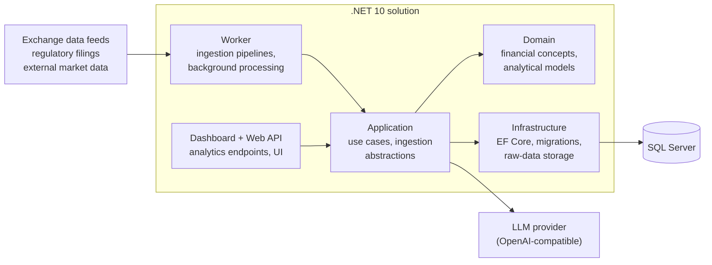

# Equity Research Platform

A **capital-market research and decision-support platform** for an emerging equity market. It collects, preserves, normalises and analyses market and company-disclosure data with full traceability, historical correctness and reproducible results.

> This is a public showcase. The source code is in a private repository; this page describes the product, the architecture and how it is being built. Status: **in active development and operational hardening**. It is a research tool, not a source of guaranteed predictions or trading signals.

## What it does

- **Market-data acquisition** from the exchange's data feeds, including historical back-fill.
- **Immutable raw-data preservation:** every response is stored with its ingestion metadata, so any result can be traced back and recomputed.
- **Instrument master and classification**, daily snapshots and price history.
- **Corporate actions:** price-adjustment and share-count history.
- **Market and industry benchmarks.**
- **Company disclosures:** discovery of regulatory filings, structured financial data, document extraction and **AI-assisted analysis**, with per-call AI cost tracking.
- **Fundamentals:** normalisation of financial statements and valuation.
- **Ownership and shareholder history.**
- **Technical indicators, signal generation and backtesting.**
- **Dashboards** and analytical UIs, plus operational pipelines and background processing.

## Architecture

Key design decisions:

- **Clean Architecture:** Domain, Application, Infrastructure and data-source projects with enforced dependency direction (architecture tests).
- **Raw first, then normalise.** Raw source data is immutable; normalised and derived data can always be rebuilt from it.
- **Historical correctness:** adjusted prices, share counts and classifications are kept as history, not overwritten.
- **AI as an assistant, not an oracle:** AI analysis of disclosures is tracked per call (provider, cost) and kept separate from source facts.
- **Architecture decisions are recorded** as ADRs, and every change produces a dated development report.

## Tech stack

| Area | Technology |
| --- | --- |
| Back end | C#, .NET 10, ASP.NET Core |
| Data | SQL Server, Entity Framework Core |
| AI | LLM integration for document analysis, with cost tracking |
| Testing | xUnit (unit, architecture and integration tests) |
| Operations | PowerShell tooling, background workers |
| Quality | Deterministic builds, nullable reference types, warnings as errors |

## How it is built: multi-model AI agents

The project is developed with a **multi-model agent orchestrator** (OpenCode), with me as architect and final reviewer:

- Separate agents for **planning, implementation and code review**, running on different models (e.g. OpenAI and DeepSeek), plus a stronger review agent and a dedicated path for **high-risk changes**.
- Shared project memory and context files, so every agent session starts from the same rules and current state.
- A chronological set of development reports and ADRs is the source of truth, not chat history.

## Author

**Mohammad Mesbah** – Senior .NET & SQL Server engineer, AI Solutions Engineer. Dubai, open to remote roles.
[LinkedIn](https://www.linkedin.com/in/mohammadhassan-mesbah) · [GitHub](https://github.com/mohammad-mesbah)
